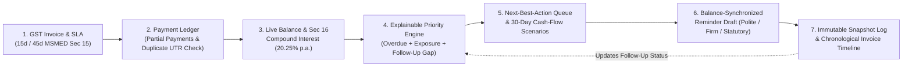

# Differentiation and Feasibility Analysis — PayTrack AI

---

## 1. Evaluation of Candidate Differentiators

We evaluated the 7 candidate differentiators for a **two-person student team** operating under strict time, data, and budget constraints (₹0 commercial API budget, existing React + Vite + TypeScript frontend, Python FastAPI backend, SQLite database).

### Scoring Rubric (1 to 5 Scale)
* **Customer Value:** `5` = Directly solves daily MSME pain; `1` = Marginal utility.
* **Difference from Competitors:** `5` = Rarely combined transparently in standard SME tools; `1` = Commodity feature.
* **Implementation Feasibility (Ease):** `5` = Achievable cleanly in existing FastAPI/React stack; `1` = Requires heavy external infra.
* **Data Requirements (Feasibility with Small/Synthetic Data):** `5` = Works reliably with deterministic ledger math on 1–50 invoices; `1` = Requires thousands of historical training rows.
* **Cost Efficiency:** `5` = ₹0 external API cost; `1` = Paid third-party APIs required.
* **Demo Impact (PitchFest):** `5` = Immediately visible, interactive "Aha!" moment for judges; `1` = Hard to see in a 3-minute live demo.
* **Low Risk:** `5` = Deterministic, testable, zero external API failure risk; `1` = High hallucination or integration failure risk.

| # | Candidate Differentiator | Customer Value (1–5) | Difference from Competitors (1–5) | Implementation Ease (1–5) | Data Feasibility (1–5) | Cost Efficiency (1–5) | Demo Impact (1–5) | Low Risk (1–5) | **Total Score (/35)** | Decision |
| :--- | :--- | :---: | :---: | :---: | :---: | :---: | :---: | :---: | :---: | :--- |
| **1** | **Explainable Collection-Priority Scoring (Configurable Rule Weights)** | 5 | 4 | 5 | 5 | 5 | 5 | 5 | **34 / 35** | **Selected (Implemented)** |
| **2** | **Payment-Aware, Balance-Synchronized Reminder Generation + Immutable Snapshots** | 5 | 4 | 5 | 5 | 5 | 5 | 5 | **34 / 35** | **Selected (Implemented)** |
| **3** | **Collection-Action Timeline Linking Invoices, Payments, Reminders & Outcomes** | 5 | 4 | 5 | 5 | 5 | 5 | 5 | **34 / 35** | **Selected (Implemented)** |
| **4** | **Daily Next-Best-Action Queue for Small-Business Owners** | 5 | 4 | 5 | 5 | 5 | 5 | 5 | **34 / 35** | **Selected (Implemented)** |
| **5** | **Transparent Short-Term Cash-Inflow Scenarios (Conservative / Baseline / Optimistic)** | 4 | 4 | 5 | 5 | 5 | 4 | 5 | **32 / 35** | **Selected (Implemented)** |
| **6** | **Evidence-Organizing Workspace for Overdue Invoices & Follow-Ups** | 4 | 4 | 4 | 5 | 5 | 5 | 4 | **31 / 35** | **Selected (Implemented)** |
| **7** | **Accounting Data Import (CSV / Tally XML) for MSME Onboarding** | 4 | 2 | 3 | 4 | 5 | 3 | 3 | **24 / 35** | **Deferred to Next Release** |

---

## 2. Validating the Positioning Hypothesis

**Hypothesis:**  
> *"PayTrack AI is an explainable receivables recovery assistant for Indian MSMEs that connects invoice balances, collection priorities, reminder drafts, payment updates, and follow-up history in one actionable workflow."*

**Central Product Message:**  
> *"Most importantly, PayTrack AI is not just another place to record overdue invoices. It turns receivables data into explainable collection actions and tracks what happens next."*

### Why This Combination is Defensible and Honest
1. **Closed-Loop State Synchronization Instead of Isolated Screens:**
   * In many basic invoicing tools, recording a partial payment updates a ledger balance, while reminder templates or historical notes sit in a separate workflow.
   * In **PayTrack AI**, recording a `₹10,000` partial payment on `INV-2026-101` (`₹4,00,000` $\to$ `₹3,90,000`) atomically:
     1. Reconciles the payment against the invoice ledger and blocks duplicate UTR references.
     2. Recalculates statutory MSMED Section 16 compound interest (`₹14,072.85` $\to$ `₹13,721.03`) and total claimable amount (`₹4,14,072.85` $\to$ `₹4,03,721.03`).
     3. Re-evaluates the deterministic priority score (`0–100`) and updates the **Daily Next-Best-Action Queue**.
     4. Regenerates the live **Reminder Draft** with the updated `₹3,90,000` principal (acknowledging `₹95,000` paid so far) while **preserving the immutable `₹4,00,000` historical snapshot** on earlier logged reminders.
     5. Appends `PAYMENT_RECEIVED` and `BALANCE_UPDATED` events to the **Invoice Follow-Up Timeline**.
2. **Explainable Deterministic Math Over "Black-Box AI" Hype:**
   * Small business owners distrust opaque scores when deciding whether to send a polite WhatsApp nudge or a formal statutory notice to a key corporate buyer.
   * Every priority score in PayTrack AI shows its exact point formula:
     $$\text{Score} = \text{Overdue Severity (max 50)} + \text{Principal Exposure (max 30)} + \text{Follow-Up/Partial Status (max 20)}$$
   * Users can inspect and adjust these weights live in the UI via the **Configure Score Weights** modal.

---

## 3. Technical & Financial Feasibility for a Two-Person Student Team

| Constraint Area | Design Choice in PayTrack AI | Why It Is Feasible & Low-Risk |
| :--- | :--- | :--- |
| **Team Size & Time** | Single monolithic FastAPI backend + React/Vite/TypeScript SPA | Zero microservice orchestration overhead; one student can own backend calculations/tests while the second owns React UI/workflow polish. |
| **Database** | Local SQLite (`paytrack.db`) with SQLAlchemy ORM | Zero cloud database hosting cost; instant setup on Windows laptops; portable single-file database for live PitchFest demos. |
| **Scoring & Forecasting** | Deterministic, configurable Python rule engine in [`calculations.py`](file:///c:/Users/Raghavi/Documents/PayTrackAI/backend/app/services/calculations.py) | Requires zero GPU/training infrastructure, never hallucinates numbers, and works accurately even when a new MSME user has only 1–10 invoices. |
| **Reminder Drafting** | Context-aware template & statutory calculation engine (with optional LLM polish hook) | Guarantees 100% mathematical accuracy on Indian Rupee amounts, Section 16 compound interest, and Section 43B(h) citations with ₹0 API cost and 0ms network latency. |
| **External Integrations** | Simulated/logged dispatch (`Logged / Simulated`) + one-click clipboard copy | Avoids paid Meta WhatsApp Business API approval delays, DLT SMS registration, or live banking credentials during a college competition. |

---

## 4. Workflow Connection Diagram

