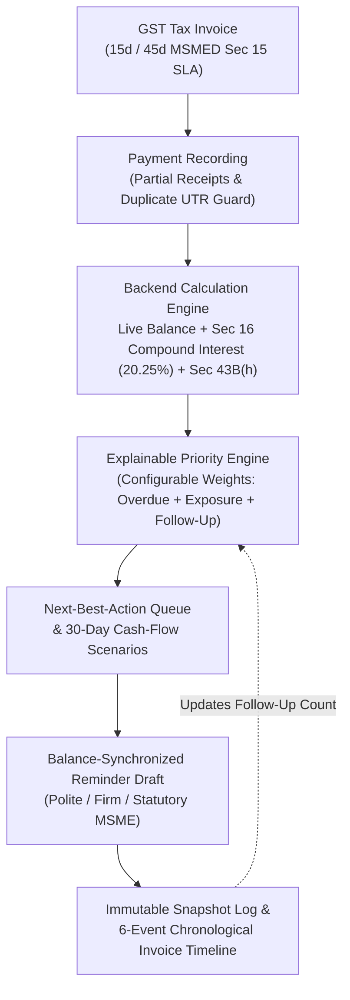

# PayTrack AI — 13-Slide College PitchFest Presentation

**Central Product Message:**  
> *"Most importantly, PayTrack AI is not just another place to record overdue invoices. It turns receivables data into explainable collection actions and tracks what happens next."*

---

## Slide 1: Title & Positioning Hypothesis
* **Title:** **PayTrack AI** — Explainable Receivables Recovery Assistant for Indian MSMEs
* **Subtitle:** Connecting Invoice Balances, Deterministic Collection Priorities, Payment-Synchronized Reminders, and Follow-Up Timelines in One Actionable Workflow
* **Team:** Two-Person Student Engineering Team | Stack: React + Vite + TypeScript, Python FastAPI, SQLite
* **Positioning Statement:**
  > *"PayTrack AI is an explainable receivables recovery assistant for Indian MSMEs that connects invoice balances, collection priorities, reminder drafts, payment updates, and follow-up history in one actionable workflow."*

---

## Slide 2: The Problem — Why MSMEs Struggle After Billing
* **The Working Capital Trap:** Indian Micro and Small Enterprises routinely face 45–90+ day payment delays from corporate buyers, locking up working capital needed for raw materials and wages.
* **The Workflow Disconnect:**
  1. Accounting tools record invoices and part-payments, but leave the business owner asking: *"Which 3 buyers should I call or message this morning, and why?"*
  2. When a buyer makes a partial payment (e.g., `₹10,000` on a `₹4,00,000` balance), static reminder templates or manual WhatsApp messages often quote stale figures, hurting credibility.
  3. Statutory protections (**MSMED Act Section 15/16** 15/45-day limits + `3× RBI Bank Rate = 20.25% p.a.` compound interest, and **Income Tax Act Section 43B(h)** buyer deduction disallowance) are rarely calculated dynamically alongside everyday follow-ups.

---

## Slide 3: Existing Landscape & Verified Competitor Comparison
* **What Existing Systems Already Do Well:**
  * **Zoho Books / Zoho Invoice:** Strong GST invoicing, customer portal, partial payment tracking, aging reports, and scheduled email reminders (Zoho Invoice is free in India).
  * **TallyPrime:** Industry-standard bill-wise accounting, ledger interest calculation, Section 43B(h) tax reports, and paid WhatsApp Business integration.
  * **CredFlow & Vyapar:** Tally-synced automated WhatsApp/SMS/IVR reminders and 30-day cash-flow views (CredFlow); simple mobile billing (Vyapar).
  * **MSME Samadhaan (`samadhaan.msme.gov.in`):** Official government portal for filing formal post-breakdown MSEFC arbitration cases.
* **Where PayTrack AI Focuses:**
  * Rather than competing as a full general-ledger ERP or claiming competitors cannot build these features, PayTrack AI focuses on the **pre-dispute daily recovery workflow**: combining **transparent, configurable priority scoring**, **partial-payment-synchronized reminder drafting**, and an **immutable invoice-to-reminder timeline**.

---

## Slide 4: Our Core Differentiator
* **Not Another Static Overdue Table:**
  > *"Most importantly, PayTrack AI is not just another place to record overdue invoices. It turns receivables data into explainable collection actions and tracks what happens next."*
* **Five Connected Capabilities in One Lightweight Loop:**
  1. **Explainable Collection Priority Score (`0–100`)** with configurable weights and visible point breakdowns.
  2. **Daily Next-Best-Action Queue** (Pre-due nudges, partial-payment reconciliations, unanswered reminder follow-ups, statutory escalations).
  3. **Payment-Aware, Balance-Synchronized Reminder Drafts** (`Polite`, `Firm`, `Statutory MSME`).
  4. **Immutable Follow-Up Timeline & Snapshot Audit Trail** (separating `Drafted`, `Edited`, and `Logged / Simulated` states).
  5. **Transparent 30-Day Cash-Inflow Scenarios** (`Conservative`, `Baseline`, `Optimistic`) with explicit assumptions.

---

## Slide 5: Explainable Collection Priority (Deterministic, Not Black-Box)
* **Why Deterministic Scoring Matters:** Small business owners will not send a firm escalation notice to a major buyer based on an unexplainable "AI number." Nor should a prototype infer "customer reliability" from only 1–2 historical invoices.
* **Transparent Formula (Configurable Live in UI):**
  $$\text{Priority Score (0–100)} = \text{Overdue Severity (0–50)} + \text{Principal Exposure (0–30)} + \text{Follow-Up / Partial Status (0–20)}$$
* **Every Queue Item Shows:**
  * Priority Level (`Critical`, `High`, `Medium`, `Low`) & exact point sum (e.g., `84/100 = 50d + 20₹ + 14f`)
  * Outstanding Principal + Section 16 Compound Interest (`20.25% p.a.`)
  * Plain-English reason why it is ranked there & Recommended Next Action.

---

## Slide 6: Closed-Loop Architecture Diagram

---

## Slide 7: Payment-Aware Reminder Synchronization & Historical Immutability
* **The Real-World Bug We Solved:**
  * In naive systems, either reminders stay stuck on stale balances after a partial payment, or updating an invoice overwrites historical logs.
* **How PayTrack AI Handles Both:**
  1. **Live Draft Synchronization:** Recording a `₹10,000` partial payment on `INV-2026-101` (`₹4,00,000` $\to$ `₹3,90,000`) immediately updates the active draft to `₹3,90,000` principal + `₹13,721.03` recalculated MSMED interest = `₹4,03,721.03` total payable.
  2. **Immutable Historical Snapshots:** Previously logged reminders retain their exact historical snapshot (`snapshot_balance_due = ₹4,00,000`) so the audit trail accurately reflects what was communicated on each date.
  3. **Honest Status Labeling:** Distinguishes `Drafted (Not Sent)`, `Draft Edited (Not Sent)`, and `Logged / Simulated (No Live Messaging Provider Connected)`.

---

## Slide 8: Single-View Evidence & Follow-Up Readiness Workspace
* **Administrative Readiness Before Escalation:**
  * Clicking **Timeline & Evidence** on any invoice opens a unified modal containing:
    1. **Invoice & Statutory Summary:** Billed amount, reconciled payments, live balance, Section 16 interest, and Section 43B(h) status.
    2. **6-Event Chronological Timeline:** `INVOICE_CREATED` $\to$ `PAYMENT_RECEIVED` $\to$ `BALANCE_UPDATED` $\to$ `REMINDER_DRAFTED` $\to$ `REMINDER_EDITED` $\to$ `REMINDER_LOGGED`.
    3. **5-Point Administrative Readiness Checklist:** Checks whether GST invoice details, credit SLA terms, UTR payment reconciliations, reminder logs, and external delivery proofs are organized.
* **Clear Scope Boundary:** Explicitly disclaimers that this is an administrative organizer, not legal advice or automated MSEFC case filing.

---

## Slide 9: Transparent 30-Day Cash-Flow Scenarios
* **Why Scenario Ranges Beat False Precision:**
  * With fewer than 10 closed historical invoices in a new MSME ledger, point-estimate ML cash-flow predictions are statistically invalid.
* **Three Transparent 30-Day Inflow Bands:**
  * **Conservative Estimate (`₹3,90,950`):** `85%` of current, `50%` of 1–15d, `25%` of 16–30d, `15%` of 31–45d, `0%` of 45+d critical dues.
  * **Baseline Estimate (`₹7,18,000`):** `100%` of current, `75%` of 1–15d, `50%` of 16–30d, `35%` of 31–45d, `25%` of 45+d critical dues.
  * **Optimistic Estimate (`₹11,23,463.90`):** Higher bucket recovery + `50%` recovery of accrued MSMED interest.
* **UI Transparency:** Displays an explicit **Data Limitation Notice** explaining the bucket assumptions.

---

## Slide 10: Live End-to-End Demo Walkthrough (`INV-2026-101`)
1. **Inspect Queue:** On the Dashboard, locate `INV-2026-101` (*Deccan Infra & Structural Steels LLP*, 62 days overdue, `₹4,00,000` balance, Priority `Critical 94/100`) and read its exact point breakdown (`50d + 30₹ + 14f`).
2. **Record Partial Payment:** Click **Record Payment**, enter `₹10,000` via UPI (`UTR-DEMO-1001`), and save.
3. **Verify Live Synchronization:** Watch Dashboard KPIs update (`₹3,90,000` remaining principal) and click **Draft Reminder**—the draft immediately shows `₹3,90,000` principal, `+₹13,721.03` recalculated Section 16 interest, and `₹4,03,721.03` total payable.
4. **Customize & Log Snapshot:** Edit the subject line, click **Log Follow-Up Snapshot**, and open **Timeline & Evidence** to see the full 6-event audit trail and verify that the older `₹4,00,000` snapshot remained intact alongside the new `₹3,90,000` snapshot.

---

## Slide 11: Feasibility for a Two-Person Student Team
* **Zero Paid Infrastructure or API Lock-In:**
  * Runs 100% locally on **React 18 + Vite + TypeScript**, **Python FastAPI**, and **SQLite** (`₹0/month` prototype cost).
  * No Kubernetes, microservices, paid WhatsApp Business API approval wait-times, or GPU dependencies required.
* **Clean Division of Labor (2 Students):**
  * **Student 1 (Backend & Statutory Math):** FastAPI endpoints, SQLite schema, Section 16 compound interest, deterministic priority engine, cash-flow scenarios, and 11-part automated validation suite.
  * **Student 2 (Frontend & UX Workflow):** React dashboard, Next-Best-Action queue, configurable weights modal, balance-synchronized reminder editor, and Invoice Timeline Workspace.

---

## Slide 12: Validation, Testing & Honest Limitations
* **11 Automated Validation & Regression Suites (`validate_calculations.py` — 100% Passing):**
  * Verifies INR formatting, Section 16 monthly compounding, priority-score determinism, configurable weights, partial-payment synchronization, duplicate UTR rejection, historical reminder snapshot immutability, status separation, next-action queue, cash-flow scenarios, and boundary/invalid inputs.
* **Current Limitations & What Requires Real-World Validation:**
  * Uses synthetic demonstration data; real-world impact on collection speed must be validated through pilot testing with 15–30 Indian MSMEs.
  * Reminders are copy-ready / simulated locally; live WhatsApp/Email delivery receipts require opt-in WABA/SMTP provider integration.
  * Does not verify external physical delivery challans or buyer quality disputes automatically.

---

## Slide 13: Realistic Product Roadmap (MVP $\to$ Next Release $\to$ Future Scale)
* **Phase 1 & 2 — Implemented Today (MVP v2.0):**
  * Explainable collection priority engine (configurable weights), Next-Best-Action queue, balance-synchronized reminders, immutable snapshots, 6-event invoice timeline, evidence checklist workspace, and 30-day cash-flow scenarios.
* **Phase 3 — Next Release (Weeks 1–6 Post-PitchFest):**
  * **CSV / Excel & TallyPrime XML Import Wizard** so MSMEs can import existing receivables in 60 seconds without manual re-entry.
  * **Promised-Payment Date Tracker** & PDF invoice/challan attachment organizer.
* **Phase 4 — Future Integrations (Months 2–6):**
  * Opt-in **WhatsApp Business API (Interakt/Gupshup)** & **UPI Payment Link** webhooks for automated status updates, plus an empirical pilot study (200+ closed invoices) to evaluate statistical payment-delay models against our deterministic baseline.
